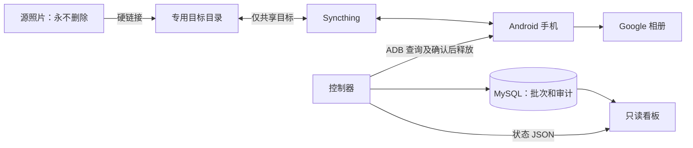

# PicSync

[](https://github.com/wylyeak/sync_pic/actions/workflows/tests.yml)
[](https://hub.docker.com/r/wangyulie/sync-pic-controller/tags)
[](https://hub.docker.com/r/wangyulie/sync-pic-dashboard/tags)

PicSync 在同一文件系统内为源照片创建硬链接，放入专用目标目录，再通过 Syncthing 同步到 Android 手机。Google 相册完成备份后，PicSync 释放手机空间，并追踪目标目录中的同步删除。只读看板展示批次、文件、异常、手机电量和备份进度。

## 开始使用

准备一台 Linux 主机、一部可使用 Google 相册备份的 Android 手机，以及同一文件系统上的源照片目录和专用同步目录。PicSync 提供 Docker Hub 镜像，无需安装 Python、配置 GitHub Actions 或在本机编译。

| 服务 | 已发布镜像 |
| --- | --- |
| 备份控制器、目录检查和可选 ADB | `wangyulie/sync-pic-controller` |
| 只读看板 | `wangyulie/sync-pic-dashboard` |

按 [用户部署教程](docs/deployment.md) 完成首次安装：

1. 下载部署文件，准备私有配置。
2. 填写照片路径、数据库密码和镜像地址，拉取镜像。
3. 连接手机，配置 Syncthing 和 Google 相册。
4. 通过只读检查，再用小批量照片验证备份流程。
5. 启动控制器，打开看板查看进度。

教程包含内置 MySQL、已有数据库、宿主机或容器 ADB，以及升级和回退方法。克隆仓库只是获取 Compose 和配套文件，不会启动服务或修改已有部署。

## 备份过程



## 部署前须知

源和目标目录必须处于同一挂载，目标目录必须专用于 PicSync。Syncthing 只共享目标目录；源照片条目始终保留。

控制器启动后会自动执行真实备份、Google 相册“释放空间”和目标清理。“释放空间”是手机上的全局操作，可能影响本批之外已经备份的内容，建议使用专用手机。首次使用请先完成教程中的配对检查和小批量验证。

看板默认只在主机本地的 `http://127.0.0.1:8027/` 开放。远程访问方法见部署教程。

- [用户部署教程：安装、配对、启动、升级与回退](docs/deployment.md)
- [配置参数参考](docs/configuration.md)
- [工作流与限制](docs/workflow.md)

## 安全边界

- 从不删除源照片条目。删除操作仅针对专用目标目录中的普通文件。
- 运行时根目录通过 `PICSYNC_SOURCE`、`PICSYNC_TARGET` 固定；TOML 和清理命令不得覆盖它们。拒绝重叠、符号链接、路径穿越、根目录替换和挂载别名。
- 源和目标必须处于同一挂载。不要分别 bind mount 两个目录；硬链接可能失败，安全检查也会拒绝这种布局。
- 删除目标硬链接后源条目仍保留，不表示实际释放了同等磁盘空间。
- Syncthing 只能挂载目标目录，不能挂载源目录或两者的共同父目录。
- 文件仅按源相对路径归属一个批次。内容变化不重新分配归属，旧指纹不能授权清理。
- 备份和删除证据不因电量展示或通知设置而放宽。详见 [工作流与限制](docs/workflow.md)。

## 配置

本机信息全部放在被 Git 忽略的 `.env`、`controller/config.toml`、`dashboard/config.toml` 和 `state/` 中。默认不启用 Bark，快捷入口为空时隐藏。

```toml
[bark]
enabled = true
error_threshold = 2  # 连续异常达到 X 次才通知；1 表示立即通知
error_interval = 3600
```

成功一次或服务重启都会清零连续失败计数；主循环与源扫描分别统计。未达通知门槛的短暂异常也不会触发恢复通知。同一批次、同一类通知仍受重复通知间隔限制。

## 开发者：源码与测试

普通部署无需执行本节。需要修改源码或自行发布镜像时，再参考 [镜像构建与发布](docs/docker-hub.md)。

```sh
python3 -m venv .venv
. .venv/bin/activate
pip install -r requirements.txt
sh scripts/test.sh
docker compose --env-file .env.example config --quiet
```

默认测试不读取 `.env`，不访问真实手机、照片或生产数据库。MySQL 集成测试需显式设置 `FILE_SYNC_TEST_MYSQL=1` 并提供隔离测试服务器，测试会创建并删除随机测试数据库，不能指向无备份的生产数据库。

`scripts/check-portability.py` 检查 Git 跟踪文件中的运行数据、私钥和明显本机地址。提交前仍应检查 `git diff --cached`。本仓库不包含第三方 APK、ADB、scrcpy 二进制或上游服务源码；这些组件按各自许可单独获取。
