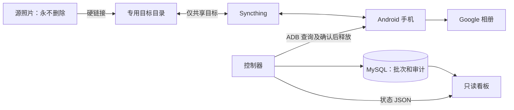

# PicSync

将同一文件系统上的源照片硬链接到专用目标目录，通过 Syncthing 送到 Android 手机，等待 Google 相册备份后释放手机空间，并追踪目标目录的同步删除。只读看板展示批次、文件、异常、手机电量和备份进度。

本仓库包含可移植的应用源码和部署模板，不包含任何实际照片、数据库、运行配置、设备编号、密钥或历史报告。现有部署不会因为克隆本仓库而被修改。

## 组成

| 目录 | 内容 |
| --- | --- |
| `controller/` | 扫描、路径唯一批次归属、备份确认、删除审计、Bark 防抖、状态采集 |
| `phone/` | 通过 ADB 操作 Google 相册；默认预览，显式执行才释放空间 |
| `dashboard/` | Flask 只读 API 与静态看板，使用单独的只读数据库账号 |
| `deploy/` | 系统 ADB、Pixel 网页适配和数据库账号示例 |
| `scripts/` | 启动、安装用户服务、测试和可移植性检查 |



## Docker Compose 部署（推荐）

需要 Linux、Docker Compose v2，以及可使用 Google 相册备份的 Android 手机。源与目标必须位于同一媒体文件系统；`state/` 放在可靠的本机存储中。

```sh
sh scripts/prepare.sh
# 编辑 .env：媒体路径、文件系统类型、设备编号和数据库密码。
# 配置文件中不包含真实部署值，首次启动前必须填写。
docker compose config --quiet
```

**外部 MySQL**：填写 `.env` 的连接地址、端口及两个独立账号，不启用 `database` profile。

**Compose 内置 MySQL**：填写两个账号密码和 `MYSQL_ROOT_PASSWORD`，执行：

```sh
docker compose --profile database up -d --build --wait mysql
```

接着按 [部署文档](docs/deployment.md) 启动 ADB、Syncthing 并完成手机配对。完成设备和目录配置后：

```sh
# 先做只读目录检查；成功后才会启动依赖它的服务。
docker compose run --rm preflight
docker compose up -d --build controller dashboard syncthing
```

默认复用宿主机的本机 ADB。需要 ADB 也在 Compose 中运行时启用 `usb` profile；不得同时运行宿主机 ADB。可选手机控制网页使用 `phone` profile。

看板仅监听 `http://127.0.0.1:8027/`，远程访问使用自己的受保护反向代理。控制器启动后会执行真实备份工作流，不是预览模式。不要在同一源目录和数据库运行旧控制器与这套 Compose。

- [完整部署、两种数据库方式、ADB 和配对步骤](docs/deployment.md)
- [全部环境变量与 TOML 参数说明](docs/configuration.md)
- [备份、释放空间和删除的证据边界](docs/workflow.md)

## 安全边界

- 从不删除源照片条目。删除动作只经过 `TargetDirectory.unlink()`，且仅针对目标目录中的普通文件。
- 运行时根目录通过 `PICSYNC_SOURCE`、`PICSYNC_TARGET` 固定；TOML 和清理命令不得覆盖它们。拒绝重叠、符号链接、路径穿越、根目录替换和挂载别名。
- 源和目标必须处于同一挂载。不要分别 bind mount 两个目录；硬链接可能失败，安全检查也会拒绝这种布局。
- 删除目标硬链接后源条目仍保留，不表示实际释放了同等磁盘空间。
- Syncthing 只能挂载目标目录，不能挂载源目录或两者的共同父目录。
- 文件仅按源相对路径归属一个批次。内容变化不重新分配归属，旧指纹不能授权清理。
- 备份和删除证据不因电量展示或通知设置而放宽。详见 [工作流与限制](docs/workflow.md)。

## 配置

本机信息全部放在被 Git 忽略的 `.env`、`controller/config.toml`、`dashboard/config.toml` 和 `state/` 中。默认不启用 Bark，快捷入口为空时隐藏。

```toml
[bark]
enabled = true
error_threshold = 2  # 连续异常达到 X 次才通知；1 表示立即通知
error_interval = 3600
```

成功一次清零连续失败计数；主循环与源扫描独立统计。未达门槛的抖动不发送恢复通知。计数在服务重启时清零；同批次、同类通知保留重复节流。

## 本地开发与测试

```sh
python3 -m venv .venv
. .venv/bin/activate
pip install -r requirements.txt
sh scripts/test.sh
docker compose --env-file .env.example config --quiet
```

默认测试不读取 `.env`，不访问真实手机、照片或生产数据库。MySQL 集成测试需显式设置 `FILE_SYNC_TEST_MYSQL=1` 并提供隔离测试服务器，测试会创建并删除随机测试数据库，不能指向无备份的生产数据库。

`scripts/check-portability.py` 检查 Git 跟踪文件中的运行数据、私钥和明显本机地址。提交前仍应检查 `git diff --cached`。本仓库不包含第三方 APK、ADB、scrcpy 二进制或上游服务源码；这些组件按各自许可单独获取。
